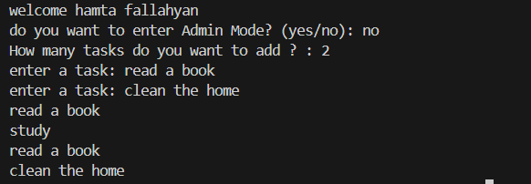
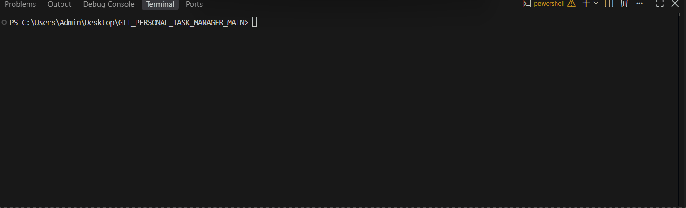

# Personal Task Manager
A simple task manager built with python

## Features
- add multiple tasks
- save tasks
- load saved tasks
- admin mode

## Requirements
- Python
- Python-dotenv

## Project Structure
```text
GIT_PERSONAL_TASK_MANAGER_MAIN/
│   .env.example
│   .gitignore
│   main.py
│   README.md
│   requirments.txt
│   tasks.py
│
├───images/
│       Animation.gif
│       screenshot.png
│
```

## Installation
Install the required packages:

```bash
pyhthon -m pip install -r requirements.txt
```

## Envoirment setup
create a `.env` file in the project folder

use `.env.example` as a template

Add your admin password

```env
admin_pass=your_password_here
```

replace `your_password_here` with your own admin password

## run the program
run the main file:
```bash
pyhthon main.py

```

## Screenshots


## Demo



